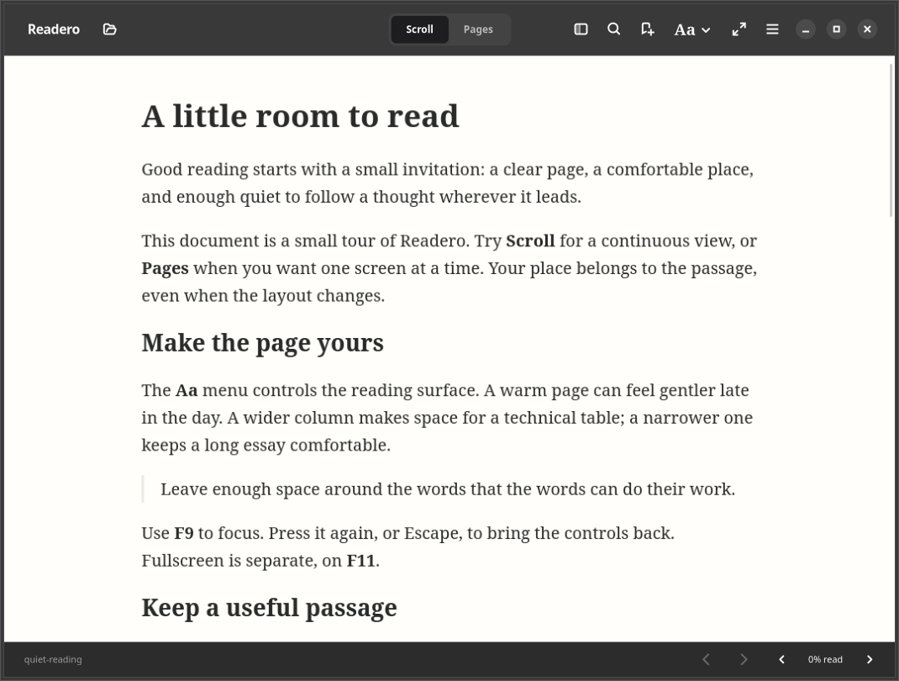

# Readero

A quiet native reader for Ubuntu, built around comfortable reading and keeping your place. Open a local PDF, DRM-free reflowable EPUB, or Markdown document; choose **Scroll** or **Pages**; return to the passage later.

Readero 0.1.1 is a working personal preview. The implementation has undergone native integration and visual checks. The complete release qualification and everyday reading sessions in the [MVP PRD](docs/MVP_PRD.md) are still separate gates; see the [implementation and QA record](docs/IMPLEMENTATION.md).

## Install locally

The supported platform is **Ubuntu 26.04**, validated on **amd64 with Papers 50.2**. Builds use the machine's native libraries and are not portable binaries for arbitrary Linux releases. GNU Make, Python 3.11+, Git, and rustup must already be available. From an existing checkout, skip the first two commands:

```sh
git clone git@github.com:michalito/readero.git
cd readero
make help            # list all commands; also the default for plain `make`
make setup           # install Ubuntu dependencies (sudo), update stable Rust, check readiness
make install         # build current source and install for your user; no sudo
```

`make setup` runs `apt-get update`, installs build and packaging dependencies, and installs/updates stable Rust with rustfmt and Clippy through rustup. If a selected older toolchain overrides stable, use `RUSTUP_TOOLCHAIN=stable make install`. If dependencies and Rust are already installed, skip setup and run `make doctor` or `make install` directly. Setup does not download or execute a rustup installer.

Installation puts the executable in `~/.local/bin/readero`, and the desktop launcher, icon, license notices, and sample document under `~/.local/share`. Launch **Readero** from the application menu or run `~/.local/bin/readero examples/quiet-reading.md`. The launcher uses the installed absolute path, so it works even if `~/.local/bin` is absent from your shell's `PATH`. Desktop caches are refreshed when the relevant utilities are available; log out and in if your desktop does not discover the new launcher immediately. Open With integration is registered without changing your default reader.

Every `make install` asks Cargo to build the current source in release mode with `--locked` and the ordinary desktop features. Cargo reuses unchanged build work. No pre-existing binary or old `.deb` in `dist/` is selected, and a previous smoke build is replaced by an ordinary build. The executable is replaced atomically, allowing an open Readero session to continue; restart it to use the new version.

### Install the latest source

```sh
make update          # fast-forward the tracked branch, then rebuild and install
# `make upgrade` is an alias
```

“Latest” means the newest commit on the current branch's configured upstream, not the newest release tag. Updates require a clean checkout (including untracked files), an attached branch, and an upstream; local changes and divergent history are never reset, stashed, or rebased automatically. For a checkout without an upstream, use `make install` for its current code, or configure your source remote and tracking branch before `make update`. Network or build failures stop installation; a build failure after a successful pull leaves the source updated and the installed app intact.

Application updates preserve `Cargo.lock` and the deliberately pinned native bindings/renderer assets. They do not run `cargo update` or upgrade those components independently. Run `make deps` and `make toolchain` when you want to refresh Ubuntu build packages and stable Rust.

### Install locations and packages

```sh
make install PREFIX="$HOME/.local"                    # default user installation
make install PREFIX=/usr DESTDIR=/tmp/readero-stage  # build a staging tree without sudo
make package                                         # create dist/readero_<version>_<arch>.deb
make install-deb                                     # build, then apt-install that exact package (sudo)
make uninstall                                       # remove the default user installation
```

`PREFIX` and `DESTDIR` must be absolute paths. Staging does not refresh host desktop caches and its launcher points to the final prefix, not the staging directory. For another prefix, use the same `PREFIX` when uninstalling. Custom desktop data locations may need to be added to `XDG_DATA_DIRS`. For system-wide installation, prefer `make install-deb` over running the build with sudo. If switching from the user installation to a package, first run `make uninstall` to avoid a user launcher shadowing the packaged version. Remove a package with `sudo apt remove readero`.

Packages use the version from `Cargo.toml`, the host architecture from dpkg, and runtime dependencies computed by `dpkg-shlibdeps`; cross-packaging is not supported. `make install-deb` supports rebuilding and reinstalling the same app version. `make uninstall` removes only the app's installed files and preserves reading history and bookmarks. `make clean` removes Cargo build products, leaving the installed app, `dist/`, and reading data intact.

Override `CARGO_TARGET_DIR` or `DIST_DIR` to relocate build products or packages. `CARGO` and `PYTHON` accept executable paths (not shell command strings). Example: `make package LOCAL_DEPS=1 CARGO_TARGET_DIR=/tmp/readero-target DIST_DIR=/tmp/readero-dist`.



## Reading

- Open through the file picker, drag-and-drop, a file argument, or Open With.
- Return through Continue/recent documents, with per-document position and appearance.
- Use contents, whole-document search, bookmarks, and Back/Forward for intentional jumps.
- Keep a plain-text notebook beside each document, with named links back to saved passages.
- Adjust reflowable text, width, line spacing, and light/warm/dark reading palettes. PDFs retain their original page colors and offer zoom, fit, and rotation.
- Focus (`F9`) hides reading controls; fullscreen (`F11`) is independent. Escape brings controls back.
- Inspect an EPUB/Markdown illustration by clicking it or focusing it and pressing Enter. Escape closes the image first and returns focus. Code and tables have keyboard scrolling when oversized.

Useful shortcuts: `Ctrl+O` Open, `Ctrl+F` Search, `Ctrl+G` / `Ctrl+Shift+G` next/previous result, `Ctrl+D` Bookmark, `Ctrl+Shift+N` Notebook, `Ctrl+Shift+S` Save selected passage, `F7` keyboard text selection, `Ctrl+L` PDF page, `Alt+Left/Right` Back/Forward, `F8` sidebar. The menu includes a shortcut reference.

Progress, bookmarks, and notebooks live in `$XDG_DATA_HOME/readero/reading.sqlite3` (normally `~/.local/share/readero/reading.sqlite3`). `READERO_DATA_DIR` selects an alternate directory for testing. On Unix, Readero restricts this directory and database to the current user before opening them. Close the app before backing up the database. Original documents are never edited or imported into a managed library. Remove from recents preserves bookmarks and notebooks. Locate reconnects a moved file.

Highlights, OCR, cloud sync, DRM, fixed-layout EPUB guarantees, PDF forms, and source editing are outside this preview. Markdown supports CommonMark, tables, task lists, strikethrough, footnotes, and heading fragments; raw HTML is displayed as text. Automatic remote content and publication scripts are disabled. Markdown sidecar resources stay within the source directory tree.

## Notebook

Use the pencil button or `Ctrl+Shift+N` to open your document's notebook. It is a
plain-text editor with shared text-and-connection undo/redo, native selection and clipboard support. Drag the
divider to resize it; narrow windows place it below the reader. Focus temporarily
hides it. Reading navigation and Markdown source reloads preserve the live draft.
Cursor, selection, scroll position and visibility return when you reopen it.

Select text in the document, then choose **Save selected passage** from its
context menu, the notebook, or `Ctrl+Shift+S`. The full quotation and source range
are saved together. The arrow menu beside that button also offers **Save current
location**, useful for illustrations or scanned pages without selectable text.
`F7` toggles keyboard text selection; use Shift+arrows in the reading view. Papers
requires upright PDF pages for new selections, so a rotated PDF offers **Rotate
upright to select**. Existing passages can be opened and marked at every rotation.

Select a sentence or several paragraphs in your notebook and choose **Connect…**
to pick a saved passage. Alternatively, use a passage's **Connect this passage to
notes** button, select your explanation, and press **Connect notes**. With only a
caret, Connect selects the current paragraph. Escape cancels a pending connection.

Connected notes are underlined. Click their adjacent source arrow or Ctrl+click
linked text to open the passage; ordinary clicks still edit your notes. One
section can have several sources, and one passage can support several sections.
Multiple sources open a chooser. Back returns to the prior reading position.
The information button shows the full saved quotation; its name is editable.

Connections follow text edits. Replacing a complete section keeps its sources;
deleting it removes its connections while preserving the saved passages. Undo
and Redo restore text and connections together. Removing a connection keeps both
notes and passage. Deleting a connected passage asks before disconnecting it.
If source words can no longer be identified confidently, Readero preserves the
quotation and offers an explicit last-known location or a previewed **Relink**.

Text and references save automatically, with a 750 ms pause and a two-second
maximum while editing. Leaving a document or closing flushes changes. Storage
failures show Retry and keep drafts in memory, including across document switches.
If Close reports an error, choose **Keep open** to preserve unsaved work. **Close
anyway** can lose it. An unreadable notebook stays disabled until Retry succeeds;
it is never silently replaced with an empty notebook.

The database upgrades transactionally to schema v3, preserving existing reading
state, bookmarks, and legacy location-only references. Older builds cannot open the upgraded database. Back it up
before upgrading if you need to return to an older build. Notebook export and
highlights remain future features. See the [notebook design](docs/NOTEBOOK.md) and [passage connections](docs/PASSAGE_CONNECTIONS.md).

## Build

`make doctor` checks Rust against `Cargo.toml` (currently 1.98) and the native library minimums: GTK 4.14, libadwaita 1.5, WebKitGTK 2.42, Papers View 49, and SQLite 3.34.1. To build without installing, use `make build`; `make run` builds and opens the app. The equivalent manual setup is:

```sh
sudo apt install build-essential pkg-config libgtk-4-dev libadwaita-1-dev \
  libwebkitgtk-6.0-dev libpapers-dev libsqlite3-dev
cargo build --locked --release
make package
```

For the current workspace, development packages were checksum-verified and extracted under `/tmp`; no system packages were installed. Reproduce that optional setup with:

```sh
make local-deps
make doctor LOCAL_DEPS=1
make install LOCAL_DEPS=1
```

`LOCAL_DEPS=1` uses `scripts/cargo-local`, a machine-specific wrapper for that temporary prefix and the cached Cargo registry at `/tmp/readero-research/cargo-home` (override with `READERO_CARGO_HOME`). It applies the same environment to preflight checks and Cargo. Existing matching Ubuntu runtime libraries, a compiler, Rust, Python, and package metadata are still required. Temporary files may disappear after reboot; rerun `make local-deps` if needed. Ordinary installations should use `make setup` instead. The native runtime remains the Ubuntu-provided one.

## Check the implementation

`make check` runs formatting, strict Clippy, Rust tests, and installer tests. `make test-core` runs Rust tests without the desktop development packages; SQLite development headers are still required. `make test-install` checks installation in temporary directories and update safeguards using temporary Git repositories. All Cargo targets support `LOCAL_DEPS=1`. The individual Rust checks are:

```sh
cargo fmt --package readero --check
cargo test --locked
cargo clippy --no-deps --all-targets --features smoke --locked -- -D warnings
```

Use `scripts/cargo-local` in place of `cargo` with the temporary development prefix. `--no-deps` keeps strict linting focused on authored code; vendored upstream bindings remain unchanged.

The opt-in `smoke` feature drives the **real native application** and captures local screenshots and assertions. It is excluded from the ordinary executable. Python Cairo, Xvfb, and `dbus-run-session` are required for the isolated display route:

```sh
python3 tests/fixtures/generate.py
cargo build --locked --release --features smoke
python3 scripts/native-smoke.py --file examples/quiet-reading.md \
  --output /tmp/readero-check-md
python3 scripts/native-smoke.py --file /tmp/readero-build/fixtures/reading.epub \
  --output /tmp/readero-check-epub --stress
cargo build --locked --release  # restore an ordinary build before packaging
```

The smoke checks include exact bookmark recovery after edits, delayed images, width changes, overlapping chapter loads and jumps, keyboard affordances, and PDF restoration at every rotation in both reading modes. Add `--edit` to exercise source watching, atomic replacement, related-file heading links, and Back/Forward using a temporary Markdown copy. Keep the smoke executable separate if running other Cargo builds concurrently; those builds can replace it with an ordinary executable.

For the protected-PDF flow, install the test-only Python `pypdf` dependency, then run `python3 tests/fixtures/protect.py /tmp/readero-build/fixtures/reading.pdf /tmp/readero-build/fixtures/protected.pdf` and pass `--protected-fixture` with that file.

Add `--notebook-only` for the focused notebook flow, including a second process
that verifies saved text, selection, and passage references after restart.
Use `--passages-only` for real source-selection capture, section connections,
relinking, shared undo, navigation indicators, and process-restart coverage.
`scripts/wayland-scale-smoke.py --passages-only` runs that flow in a private
GNOME compositor at its requested scales without changing the host display.

Use a fresh output directory for each run. Evidence contains reading locators, passages, and screenshots: keep personal-document runs outside the repository. `checks.json` contains only safe boolean outcomes. `--wayland` exercises the current desktop; the default uses Xvfb/software rendering. These flows establish behavior, not PRD startup/frame-time percentiles.

`--startup-only` limits the flow to Home, opening, native snapshots, and closing,
for repeated startup trials. `--startup-recovery` deliberately stalls WebKit past
the 30-second opening deadline and checks recovery, preservation of notes, retry,
and cancellation. It takes about 100 seconds and uses only the isolated test data.

Separate native probes use the optimized application without the smoke driver's fixed navigation waits:

```sh
python3 scripts/native-qualify.py --binary /path/to/smoke-enabled-readero \
  --file examples/quiet-reading.md --output /tmp/readero-restart --mode restart
python3 scripts/native-qualify.py --binary /path/to/smoke-enabled-readero \
  --file examples/quiet-reading.md --output /tmp/readero-timing --mode timing
python3 scripts/native-qualify.py --binary /path/to/smoke-enabled-readero \
  --file examples/quiet-reading.md --output /tmp/readero-notebook-perf \
  --mode notebook --backend x11
xvfb-run -a dbus-run-session -- python3 scripts/accessibility-smoke.py \
  --binary /path/to/readero --output /tmp/readero-accessibility
python3 scripts/wayland-scale-smoke.py --binary /path/to/smoke-enabled-readero \
  --file examples/quiet-reading.md --output /tmp/readero-scales
```

`restart` checks forced termination, an interrupted SQLite writer, and closing during a layout change, all against isolated state. `timing` collects 10 launches and 30 reopens on the current Wayland desktop; `idle` measures the actual app process tree after 40 turns and 20 mode changes. These are diagnostic observations, not a claim that the full PRD performance protocol has passed. The accessibility script inspects native controls, headings, and text through AT-SPI; it does not run an Orca usability session. Python GI/AT-SPI bindings are required for that check.

`notebook` measures native editing, scroll-position lookup, and saving with large
generated notebooks. `notebook-idle` measures the app process tree after reading
and editing with the notebook open. All probes support `--backend x11` for an
isolated Xvfb display; the default uses the current Wayland desktop. Exceptionally
long single paragraphs remain more expensive for GTK to lay out than the same
amount of text divided into paragraphs.

The scale harness uses a private headless GNOME compositor and virtual keyboard
at 100%, 125%, 150%, and 200%, checking the actual GDK backend and surface scale.
It never changes the current desktop's display settings. GNOME Shell and Python
GI are required; repeat `--file` to cover multiple formats. The fixture generator
also creates an EPUB 2/NCX book, a 1,200-page PDF, and an 80-page image-only PDF.

Add `--orca` to the accessibility command to run real Orca announcement and
keyboard checks. It requires Orca, Speech Dispatcher, and Python Xlib, and uses
private settings plus a silent speech output module. This verifies announcement
generation, typing, undo/redo, and passage-reference editing; a human listening
and usability session remains separate. Readiness/idle probes now request
1050 × 800 logical pixels and record the actual size, backend, renderer, and scale.

## Code and decisions

Rust/GTK4/libadwaita own the shell; Papers owns PDF rendering; WebKitGTK with pinned foliate-js handles EPUB and rendered Markdown. A dedicated worker owns SQLite. Document identity and versioned locators are independent of the presentation mode, with linked notebooks using the same identities and locators.

- [Finalized MVP PRD](docs/MVP_PRD.md)
- [Future features and proposed roadmap](docs/ROADMAP.md)
- [Stack decisions and sources](docs/STACK_DECISIONS.md)
- [Implementation and QA](docs/IMPLEMENTATION.md)
- [Original component research](docs/research/VALIDATION.md)
- [Upstream provenance and licenses](vendor/README.md)

This is a personal project. Upstream source and license notices are preserved in `vendor/` and `assets/foliate/`.
